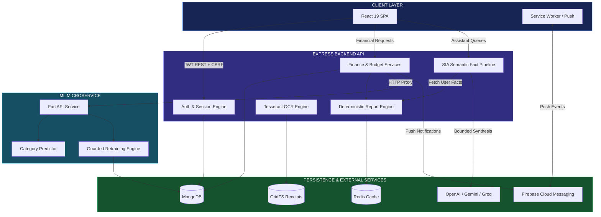
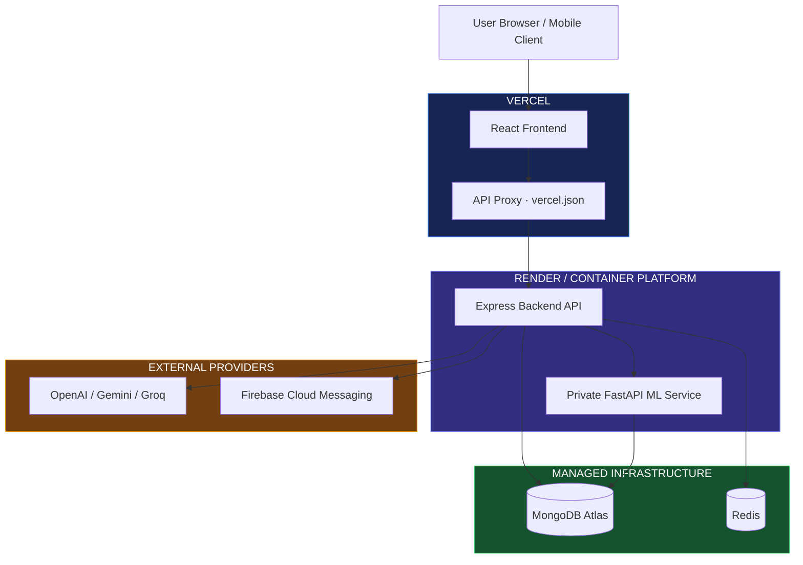

# ✨ BALENSIA

<p align="center">
  
  <br /><br />
  <strong>Understand Your Money. Make Smarter Financial Decisions.</strong>
  <br />
  <sub>A full-stack personal finance platform powered by deterministic analytics, machine learning, and a privacy-focused financial AI assistant.</sub>
  <br /><br />
  <a href="https://github.com/nareshjo001/expense-manager">
    
  </a>
  
  
  
  
  
</p>

---

## ◈ About BALENSIA

BALENSIA is a modern, full-stack personal finance platform designed to help users record financial activity, understand spending habits, manage budgets, and make informed financial decisions.

It combines rigorous accounting principles, deterministic financial analytics, machine learning assistance, and SIA — a security-hardened personal financial AI assistant grounded in verified user data.

Rather than relying entirely on generative AI for financial insights, BALENSIA uses deterministic calculations for its core analytics and applies AI selectively for natural-language assistance and explanation.

**The platform brings together:**

- Accurate financial transaction management.
- Intelligent expense categorization.
- Receipt scanning and transaction linking.
- Category budgets and overall spending limits.
- Deterministic analytics and spending forecasts.
- Secure financial data import and export.
- SIA — a read-only, context-aware financial assistant.
- Responsive web and mobile experiences.

---

## ◈ Platform at a Glance

| Platform Layer | Technology |
|:---|:---|
| Frontend | React 19 |
| Backend | Node.js, Express 4 |
| ML Microservice | Python, FastAPI, Scikit-Learn |
| Database | MongoDB, GridFS |
| Caching | Redis |
| AI Integrations | OpenAI, Google Gemini, Groq |
| Notifications | Firebase Cloud Messaging |
| Mobile | Capacitor |

---

## ◈ Explore the Documentation

| Section | Description |
|:---|:---|
| [01 — Platform Capabilities](#01--platform-capabilities) | Core financial and intelligent features |
| [02 — System Architecture](#02--end-to-end-system-architecture) | How the platform components communicate |
| [03 — Architecture Portals](#03--interactive-architecture-portals) | Live frontend, backend, and ML architecture |
| [04 — Repository Structure](#04--repository-structure) | Monorepo organization |
| [05 — Technology Stack](#05--technology-stack) | Technologies used across the platform |
| [06 — Local Setup](#06--local-development-setup) | Running all services locally |
| [07 — Testing](#07--testing--quality-assurance) | Test suites and quality gates |
| [08 — Security](#08--security--privacy) | Security and privacy principles |
| [09 — Deployment](#09--production-deployment) | Production hosting architecture |
| [10 — Service Documentation](#10--service-documentation) | Detailed engineering guides |

---

# 01 — Platform Capabilities

BALENSIA combines accurate financial recordkeeping with intelligent assistance and analytical insights.

## 1.1 Exact Minor-Unit Accounting

<badge color="success">Financial Integrity</badge>

Based on **ADR-0003**, all transaction amounts are stored and calculated using authoritative integer minor units (paise).

- Eliminates floating-point arithmetic errors.
- Maintains consistent financial calculations.
- Supports accurate transaction aggregation.
- Formats currency using the Indian numbering system.

Example:

```text
Stored amount: 12345650 paise

Displayed amount: ₹1,23,456.50
```

## 1.2 Receipt OCR & Smart Linking

<badge color="info">Automated Extraction</badge>

BALENSIA extracts transaction information from receipt images using an isolated Tesseract OCR processing pipeline.

- Dedicated worker-thread OCR execution.
- Per-field confidence scoring.
- Bounding-box preservation.
- Streaming receipt storage using MongoDB GridFS.
- Candidate matching to prevent duplicate entries.

## 1.3 Category Budgets & Spending Limits

<badge color="success">Budget Management</badge>

Users can establish monthly financial limits at both category and overall spending levels.

- Individual category budgets.
- Overall monthly spending caps.
- Real-time spending meters.
- Visual threshold alerts.
- Monthly budget monitoring.

## 1.4 Unified Data Import & Export

<badge color="info">Data Portability</badge>

Provides structured financial data transfer through import and export workflows.

**Import**
- Bank statement CSV uploads.
- Interactive column mapping.
- Row-by-row staging.
- Controlled transaction processing.

**Export**
- Structured CSV and JSON exports.
- User-scoped financial data.
- Signed, secure download tokens.

## 1.5 Interactive Financial Visualizations

Explore financial activity through interactive charts and comparative views.

- Multi-year spending comparisons.
- Monthly category breakdowns.
- Expense distribution charts.
- Visual spending trends.

The visualization layer is powered by Recharts.

## 1.6 Deterministic Analytics & Monthly AI Summary

<badge color="success">Data-Driven Insights</badge>

BALENSIA uses deterministic statistical methods for financial analysis.

| Analytical Method | Purpose |
|:---|:---|
| Theil-Sen Estimator | Non-parametric spending forecasts |
| Median Absolute Deviation (MAD) | Anomaly detection |
| Habit Analysis | Spending-pattern identification |
| Monthly AI Narrative | Natural-language explanation of verified financial facts |

An optional LLM-generated monthly narrative complements deterministic results. Its content is grounded in verified financial facts rather than independently inventing financial figures.

## 1.7 SIA — Smart Intelligent Assistant

<badge color="info">AI-Powered Assistance</badge>

SIA is a read-only semantic personal finance assistant that allows users to interact with their own financial information using natural language.

**Core capabilities**

- Natural-language financial queries.
- Allowlisted semantic query planning.
- User-scoped financial aggregates.
- Verified fact retrieval.
- Optional speech-to-text transcription.
- Speech read-aloud support.
- Strict grounding disclosures.

SIA uses an optional LLM synthesis layer while keeping financial data access controlled by the backend.

## 1.8 Security, Privacy & Account Deletion

<badge color="success">Security First</badge>

The platform incorporates multiple security mechanisms:

- Short-lived in-memory JWT access tokens.
- Rotating HttpOnly refresh cookies.
- CSRF protection for sensitive mutations.
- HMAC-based audit pseudonymization.
- Two-tier account deletion.
- User-scoped financial data access.
- Isolated OCR execution.

## 1.9 Responsive Interface & Balenisa Design System

The frontend follows a consistent visual design system across desktop and mobile.

- Vertical heading accent lines.
- Fixed 1040px desktop containers.
- Fluid mobile spacing.
- Responsive layouts.
- Automatic light and dark theme adaptation.
- Consistent component styling.

---

# 02 — End-to-End System Architecture

BALENSIA follows a modular architecture consisting of three core service layers: the React client, Express backend, and Python ML microservice.

MongoDB and Redis provide persistence and caching, while external AI and notification providers support selected application capabilities.

## Complete System Architecture



## Architectural Security Invariant

> **The browser client NEVER connects directly to MongoDB, Redis, the ML service, or external LLM providers.**

All authorization, financial mutations, data masking, and rate limiting are exclusively governed by the Express backend.

This separation ensures that the frontend interacts with controlled application APIs rather than directly accessing internal infrastructure or external AI providers.

---

# 03 — Interactive Architecture Portals

Explore each service through its dedicated, interactive architecture specification.

These portals provide a deeper view of component responsibilities, internal workflows, service interactions, and implementation architecture.

<p align="center">
  <a href="https://nareshjo001.github.io/balensia-frontend-architecture/">
    
  </a>
  <br />
  <sub>React application structure, components, state, and frontend workflows</sub>
  <br /><br />
  <a href="https://nareshjo001.github.io/balensia-backend-architecture/">
    
  </a>
  <br />
  <sub>Express services, financial engines, APIs, and backend workflows</sub>
  <br /><br />
  <a href="https://nareshjo001.github.io/balensia-ml-service-architecture/">
    
  </a>
  <br />
  <sub>Prediction engine, retraining pipeline, validation, and model lifecycle</sub>
</p>

| Architecture Tier | Live Architecture |
|:---|:---|
| Frontend | [Explore Frontend Architecture](https://nareshjo001.github.io/balensia-frontend-architecture/) |
| Backend | [Explore Backend Architecture](https://nareshjo001.github.io/balensia-backend-architecture/) |
| ML Service | [Explore ML Service Architecture](https://nareshjo001.github.io/balensia-ml-service-architecture/) |

---

# 04 — Repository Structure

BALENSIA is organized as a modular monorepo containing three core services and centralized engineering documentation.

```text
expense-manager/
│
├── frontend/
│   └── React application
│       ├── UI components
│       ├── Pages and layouts
│       ├── Application state
│       └── Client-side workflows
│
├── backend/
│   └── Express API
│       ├── Authentication and sessions
│       ├── Financial services
│       ├── Analytics and reporting
│       ├── Receipt OCR
│       ├── SIA assistant
│       └── Notifications
│
├── ml-service/
│   └── Python ML microservice
│       ├── Category prediction
│       ├── Dataset preparation
│       ├── Model training
│       └── Model validation and activation
│
├── docs/
│   ├── Architecture documentation
│   ├── API workflow guides
│   └── Architecture decision records
│
└── README.md
```

### Service Documentation

| Directory | Responsibility | Primary Technologies | Documentation |
|:---|:---|:---|:---|
| `frontend/` | User interface and client state | React 19, TanStack Query v5, Recharts, Material UI | [Frontend README](frontend/README.md) |
| `backend/` | Core financial API and orchestration | Node.js, Express 4, Mongoose, Redis, Tesseract.js | [Backend README](backend/README.md) |
| `ml-service/` | Category inference and model lifecycle | Python, FastAPI, Scikit-Learn, Pandas | [ML Service README](ml-service/README.md) |
| `docs/` | Architecture and API workflow documentation | Markdown, SVG diagrams, ADRs | [Documentation Index](docs/api-workflows/README.md) |

---

# 05 — Technology Stack

The platform uses a combination of frontend, backend, machine learning, persistence, and external integration technologies.

## Technology Matrix

| Layer | Technologies & Libraries |
|:---|:---|
| **Frontend** | React 19, React Router 6, TanStack Query v5, Recharts, Capacitor, Material UI, Date-fns, Web Vitals |
| **Backend** | Node.js 18–22, Express 4, Mongoose 8, Redis 4, Tesseract.js 6, Multer, Helmet, Joi, Node-Cron |
| **ML Service** | Python 3.10–3.14, FastAPI 0.139, Uvicorn, Scikit-Learn 1.9, NumPy 2, Pandas 3, PyMongo 4 |
| **Database & Cache** | MongoDB, GridFS, Redis |
| **AI Integrations** | OpenAI, Google Gemini, Groq |
| **Notifications** | Firebase Cloud Messaging |
| **Mobile Runtime** | Capacitor |

## Technology Responsibilities

| Technology | Role in BALENSIA |
|:---|:---|
| React | Responsive user interface |
| TanStack Query | Server-state management |
| Express | Core application API and orchestration |
| FastAPI | Machine learning service API |
| Scikit-Learn | Expense category classification |
| MongoDB | Financial and application data persistence |
| GridFS | Receipt file storage |
| Redis | Analytics and session caching |
| Tesseract.js | Receipt text extraction |
| Recharts | Financial data visualization |
| Firebase | Web and native push notifications |
| OpenAI / Gemini / Groq | Optional SIA language synthesis |

---

# 06 — Local Development Setup

## Prerequisites

Ensure the following tools and services are available before starting BALENSIA.

| Requirement | Version / Configuration |
|:---|:---|
| Node.js | 18.0.0 or higher |
| npm | Compatible with installed Node.js |
| Python | 3.10–3.14 |
| MongoDB | `mongodb://localhost:27017` |
| Redis | `redis://localhost:6379` |

## Step 1 — Clone the Repository

```bash
git clone https://github.com/nareshjo001/expense-manager.git

cd expense-manager
```

## Step 2 — Start the ML Service

Open a terminal and navigate to the ML service directory.

```bash
cd ml-service

# Create virtual environment
python -m venv venv
```

Activate the environment.

**Windows**

```powershell
venv\Scripts\activate
```

**macOS / Linux**

```bash
source venv/bin/activate
```

Install dependencies and start FastAPI.

```bash
pip install -r requirements.txt

uvicorn app:app --host 0.0.0.0 --port 8000 --reload
```

<badge color="success">ML Service</badge> `http://localhost:8000`

## Step 3 — Start the Backend API

Open a new terminal.

```bash
cd backend

npm install

npm run dev
```

<badge color="success">Backend API</badge> `http://localhost:8080`

## Step 4 — Start the Frontend

Open another terminal.

```bash
cd frontend

npm install

npm start
```

<badge color="success">Frontend</badge> `http://localhost:3000`

## Local Service Overview

| Service | Local Address |
|:---|:---|
| Frontend | `http://localhost:3000` |
| Backend API | `http://localhost:8080` |
| ML Service | `http://localhost:8000` |
| MongoDB | `mongodb://localhost:27017` |
| Redis | `redis://localhost:6379` |

> **Configuration note:** Each service may require its own environment variables. Refer to the individual service README files for complete configuration instructions.

---

# 07 — Testing & Quality Assurance

Each BALENSIA service is backed by dedicated test suites and CI quality gates.

## Testing Matrix

| Tier | Command | Scope |
|:---|:---|:---|
| Frontend | `cd frontend && npm test -- --watchAll=false` | 864 unit and component tests across 85 suites |
| Frontend CI Lint | `cd frontend && npm run lint:ci` | ESLint CI gate enforcing zero errors and zero warnings |
| Performance Budgets | `cd frontend && npm run perf:budgets` | Gzip size ceilings across all seven bundle micro-chunks |
| Backend | `cd backend && npm test` | Unit, route, security, and financial integrity tests |
| Backend Integration | `cd backend && npm run test:integration` | Database, Redis, and API contract integration suites |
| OCR Benchmark | `cd backend && npm run eval:ocr` | Receipt extraction benchmark against annotated ground truth |
| ML Service | `cd ml-service && pytest` | ML inference contracts, retraining gates, and failure injection |

## Quality Assurance Coverage

**Frontend**
- Component and unit testing.
- Client-side behavior verification.
- Linting and code-quality checks.
- Bundle performance budgets.

**Backend**
- API and route testing.
- Financial integrity validation.
- Authentication and security testing.
- Database and Redis integration.
- OCR extraction benchmarking.

**ML Service**
- Prediction and API contract testing.
- Model validation gates.
- Retraining workflow testing.
- Failure-injection scenarios.

---

# 08 — Security & Privacy

Security is an architectural requirement across all BALENSIA service layers.

## Core Security Principles

### 1. Token Hygiene

Access tokens are maintained in volatile JavaScript memory.

Long-lived session persistence relies on HttpOnly, SameSite, Secure cookies.

### 2. Double-Submit CSRF Protection

Critical state-changing requests require matching cryptographic CSRF tokens transmitted through custom request headers.

### 3. Restricted SIA Data Access

SIA operates through allowlisted summary projections.

It cannot:

- Inspect unauthenticated records.
- Execute arbitrary aggregation pipelines.
- Access unrestricted database collections.
- Mutate financial records.

### 4. Data Isolation & Account Deletion

Account deletion immediately removes personal data across expenses, incomes, budgets, receipts, and sessions, followed by scheduled background cleanup of file storage.

### 5. OCR Worker Isolation

Receipt OCR executes in dedicated worker threads with strict execution time limits through `OCR_TIMEOUT_MS`.

This prevents long-running OCR operations from blocking the primary HTTP event loop.

### Security Architecture Principle

> Financial data access, authorization, and mutations remain under backend control. AI services receive only the information permitted by their defined application workflows.

---

# 09 — Production Deployment

BALENSIA uses a distributed deployment architecture in which each service is hosted according to its responsibilities.

## Deployment Architecture



## Deployment Responsibilities

| Component | Platform | Deployment Details |
|:---|:---|:---|
| Frontend | Vercel | Root directory configured as `frontend` |
| Backend API | Render or equivalent container platform | Express application with managed MongoDB Atlas and Redis |
| ML Service | Private container service | Accessible only to Express backend through shared `ML_OPERATIONS_TOKEN` |
| Database | MongoDB Atlas | Managed document database |
| Cache | Managed Redis | Session and analytics caching |

### Frontend Routing

The frontend uses `vercel.json` to proxy `/backend/*` requests to the backend API.

This preserves first-party cookie domains for the application's authentication flow.

### Backend-to-ML Communication

The ML service is deployed as a private service.

The Express backend communicates with it using the shared `ML_OPERATIONS_TOKEN`, preventing direct browser access to the ML infrastructure.

---

# 10 — Service Documentation

Explore the individual engineering guides and live architecture specifications for each BALENSIA service.

## Frontend Engineering

<p align="center">
  
</p>

**Explore the frontend implementation, component structure, client state, and application workflows.**

- [Frontend Component & Application Guide](frontend/README.md)
- [Live Frontend Architecture Portal](https://nareshjo001.github.io/balensia-frontend-architecture/)

## Backend Engineering

<p align="center">
  
</p>

**Explore the financial API, authentication, OCR, analytics, SIA, and backend service architecture.**

- [Backend API & Services Guide](backend/README.md)
- [Live Backend Architecture Portal](https://nareshjo001.github.io/balensia-backend-architecture/)

## Machine Learning Engineering

<p align="center">
  
</p>

**Explore category prediction, confidence calibration, guarded retraining, and model lifecycle management.**

- [ML Service & Retraining Lifecycle Guide](ml-service/README.md)
- [Live ML Service Architecture Portal](https://nareshjo001.github.io/balensia-ml-service-architecture/)

## API & Architecture Documentation

- [API Workflows & Decision Records](docs/api-workflows/README.md)

---

<p align="center">
  <br />
  <strong>MORE THAN EXPENSE TRACKING.</strong>
  <br />
  <strong>A SMARTER WAY TO UNDERSTAND YOUR FINANCES.</strong>
  <br /><br />
  <sub>Accurate accounting · Deterministic insights · Intelligent assistance</sub>
  <br /><br />
  <a href="https://balensia.vercel.app/">
    <strong>🚀 Try BALENSIA Live</strong>
  </a>
  <br /><br />
  <a href="https://github.com/nareshjo001/expense-manager">
    <strong>Explore BALENSIA on GitHub →</strong>
  </a>
  <br /><br />
  <sub>© BALENSIA · Personal Finance Platform</sub>
</p>