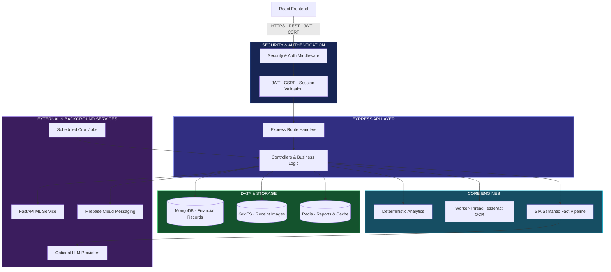
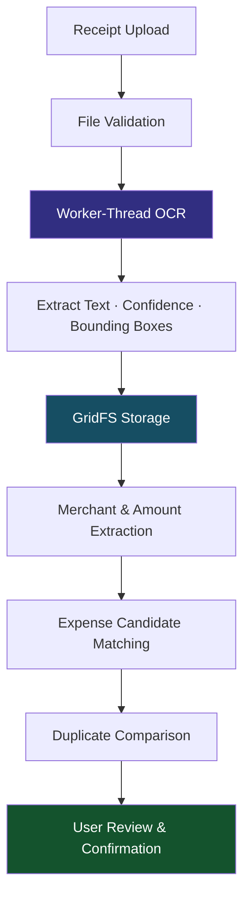
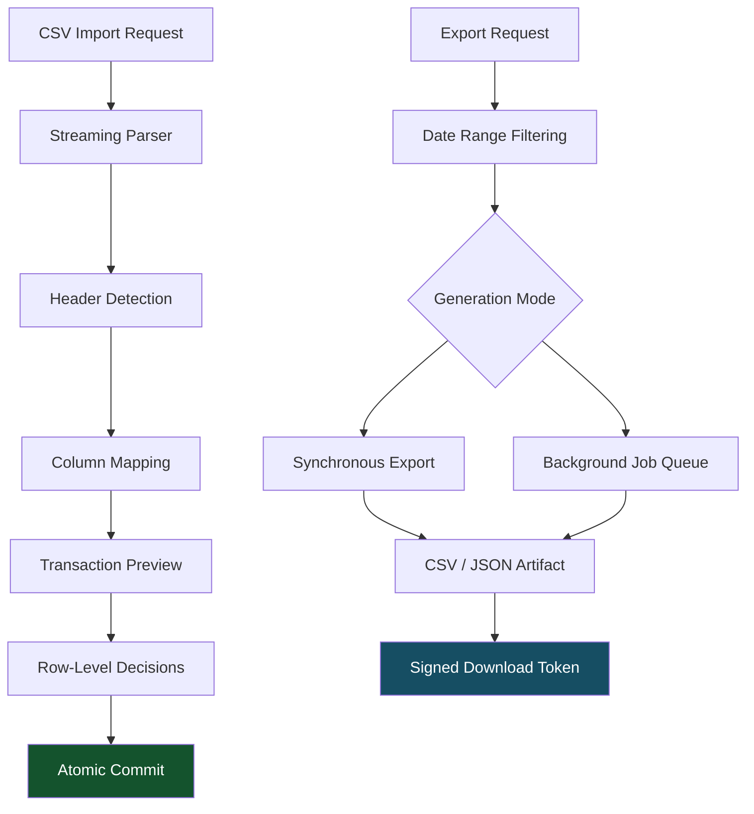
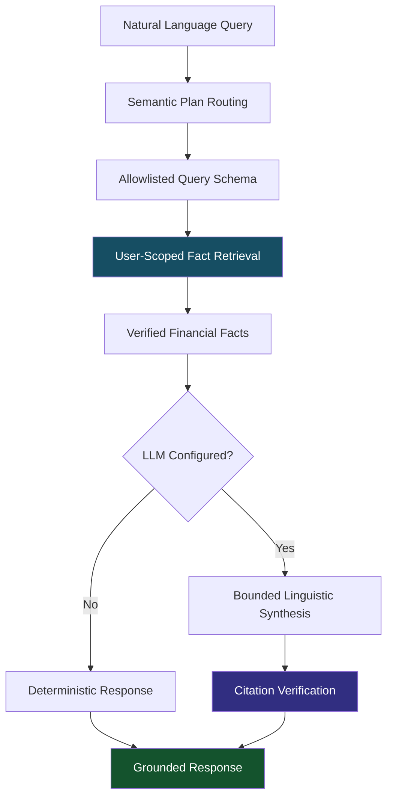

# BALENSIA — Backend Engine

<p align="center">
  
  <br /><br />
  <strong>The Financial Engine Powering BALENSIA</strong>
  <br />
  <sub>Secure financial operations · Intelligent document processing · Deterministic analytics · AI orchestration</sub>
  <br /><br />
  <a href="https://github.com/nareshjo001/expense-manager">
    
  </a>
  
  
  
  
  <br />
  
  
  
</p>

---

## ◈ About BALENSIA

The BALENSIA Backend is the central financial engine powering the application's business logic, security, data persistence, and intelligent services.

Built with **Node.js, Express.js, MongoDB, and Redis**, it provides a robust API ecosystem responsible for financial transaction management, identity and session security, receipt processing, deterministic analytics, and AI-assisted financial intelligence.

Beyond conventional CRUD operations, the backend incorporates specialized engineering mechanisms for exact financial accounting, isolated OCR processing, transactional data imports, asynchronous exports, privacy-aware account deletion, and grounded AI responses.

**The backend brings together six major engineering domains:**

- Secure authentication and session lifecycle management.
- Exact minor-unit financial accounting.
- Receipt OCR and intelligent expense matching.
- Streaming data import and multi-format export.
- Deterministic financial analytics and forecasting.
- SIA semantic intelligence and ML service integration.

---

## ◈ Explore the Backend

| Section | What You'll Discover |
|:---|:---|
| [01 — System Architecture](#01--system-architecture) | Backend components and service communication |
| [02 — Core Engines](#02--core-engines--responsibilities) | Financial accounting, OCR, analytics, and SIA |
| [03 — API Route Catalog](#03--api-route-catalog) | Complete backend API organization |
| [04 — Security & Privacy](#04--security--privacy-architecture) | Authentication, data protection, and deletion |
| [05 — Local Setup](#05--setup--local-execution) | Installation and development execution |
| [06 — Environment Configuration](#06--environment-configuration) | Backend environment variables |
| [07 — Database & Backup](#07--database-migrations--backup-tools) | Migrations, encrypted backups, and restore |
| [08 — OCR Evaluation](#08--ocr-ground-truth-evaluation) | Receipt extraction benchmarking |
| [09 — Testing](#09--testing--quality-assurance) | Unit, integration, and lint checks |
| [10 — Related Documentation](#10--related-documentation) | Complete BALENSIA engineering ecosystem |

---

# 01 — System Architecture

## Backend Service Architecture

The BALENSIA backend acts as the central coordination layer between the React frontend, persistent storage, machine learning services, and external integrations.

### Interactive Architecture Specification

Explore the complete backend architecture through the live interactive visualizer.

<p align="center">
  <a href="https://nareshjo001.github.io/balensia-backend-architecture/">
    
  </a>
</p>

### System Communication Flow



### Architectural Responsibilities

| Component | Responsibility |
|:---|:---|
| Security Middleware | Authentication, authorization, and request protection |
| Express Routers | API endpoint registration and request routing |
| Controllers | Request handling and coordination |
| MongoDB | Persistent financial and application records |
| GridFS | Receipt image storage |
| Redis | Report caching and cache operations |
| Analytics Engine | Deterministic financial calculations |
| OCR Engine | Receipt text extraction and confidence analysis |
| SIA Engine | Semantic planning and grounded financial responses |
| FastAPI ML Service | Category prediction and description generation |
| Firebase | Push notification delivery |
| Cron Jobs | Scheduled background operations |

---

# 02 — Core Engines & Responsibilities

BALENSIA's backend contains specialized engines designed to handle financial precision, document intelligence, statistical analysis, and AI-assisted financial interactions.

## 2.1 Exact Minor-Unit Accounting

<sub>Architecture Decision Record: ADR-0003</sub>

### Financial Precision Through Integer Paise

All currency operations are stored and computed authoritatively using **integer minor units (paise)**.

```text
100 paise = ₹1.00
```

**Why integer-based accounting?**

Floating-point arithmetic can introduce representation errors when performing financial calculations.

For example:

```javascript
0.1 + 0.2 !== 0.3
```

BALENSIA avoids using floating-point values as the authoritative financial representation.

**Key characteristics**

- Integer paise as the source of truth.
- Accurate financial addition and subtraction.
- Reduced risk of IEEE-754 floating-point drift.
- Consistent financial calculations across the application.
- Indian Numbering System formatting.

**Currency representation**

| Value in Paise | Formatted INR |
|---:|---:|
| 100 | ₹1.00 |
| 1,250 | ₹12.50 |
| 10,000 | ₹100.00 |
| 12,345,650 | ₹1,23,456.50 |

Formatting follows the `en-IN` locale.

## 2.2 Receipt OCR & Smart Matching Engine

### Intelligent Receipt Processing

The receipt engine combines isolated OCR execution, spatial text extraction, secure image storage, and automated expense matching.

**Isolated OCR Processing**

- Multi-page receipt scanning.
- Bounded worker-thread execution.
- Per-attempt timeout through `OCR_TIMEOUT_MS`.
- Controlled processing to avoid unbounded OCR execution.

**Bounding Boxes & Confidence**

Extracts structured OCR information:

- Line-level extracted text.
- Confidence scores from 0–100.
- Spatial bounding boxes through `bbox`.
- Receipt field verification support.

**GridFS Blob Storage**

- Streaming receipt image storage.
- Separation of binary files from transactional documents.
- Secure receipt retrieval.
- Cascading cleanup during deletion.

**Smart Expense Linking**

Automatically identifies potential matching expenses using:

- Merchant-name tokenization.
- Date proximity.
- Exact integer-paise amount comparison.
- Duplicate candidate comparison.
- User confirmation or dismissal.

### Receipt Processing Flow



## 2.3 Data Transfer Engine

### CSV Import & Multi-Format Export

The backend provides a unified data transfer pipeline for importing and exporting financial records.

**Streaming CSV Import**

- Memory-bounded chunked CSV parsing.
- Automatic header detection.
- Column mapping.
- Transaction preview.
- Row-by-row staging.
- Explicit row-level decisions.
- Atomic rollback when an import is discarded.

**Data Export Pipeline**

- Synchronous export generation.
- Asynchronous background export jobs.
- CSV and JSON formats.
- Date-range filtering.
- Signed single-use download tokens.

### Data Transfer Lifecycle



## 2.4 Deterministic Analytics & Monthly Reports

### Statistical Financial Intelligence

The analytics engine produces financial insights using deterministic algorithms and statistical techniques.

**Spending & Habit Analysis**

- Impulse purchase categorization.
- Weekend spending ratios.
- Subscription trend analysis.
- Spending behavior evaluation.

**Statistical Anomaly Detection**

Uses Median Absolute Deviation (MAD) to identify unusual spending behavior while filtering benign routine spikes.

**Theil-Sen Trend Forecasting**

Uses robust non-parametric regression to estimate future monthly spending trajectories.

Unlike ordinary least-squares regression, Theil-Sen estimation is less sensitive to isolated outlier months.

**Budget Pressure & Warnings**

- Continuous category-spend monitoring.
- Comparison against allocated budget caps.
- Budget pressure identification.
- Financial warning generation.

## 2.5 SIA — Smart Intelligent Assistant

### Grounded Financial Intelligence

SIA is a semantic financial assistant designed around controlled query planning and evidence-grounded responses.

Its defining architectural constraint is:

<badge color="success">Read-only by design</badge>

SIA has no write capability over expenses, income, budgets, or user accounts.

**Semantic Plan Routing**

- Converts natural-language queries into an allowlisted plan schema.
- Prevents exposure of raw SQL or MongoDB syntax.
- Restricts operations to supported query plans.

**Grounded Facts Pipeline**

1. Receives the user's financial question.
2. Generates an allowlisted semantic query plan.
3. Retrieves authorized, user-scoped financial aggregates.
4. Constructs a structured facts snapshot.
5. Optionally invokes an LLM provider for linguistic synthesis.
6. Verifies response citations using `citedFactIds`.
7. Returns a grounded response.

**Optional LLM Providers**

- OpenAI.
- Google Gemini.
- Groq.

LLMs perform bounded linguistic synthesis over retrieved facts rather than directly accessing financial databases.

**Voice Transcription**

- Accepts multipart audio recordings.
- Uses server-side speech-to-text integration.
- Supports voice-driven financial queries.

### SIA Grounding Flow



## 2.6 Privacy & Two-Tier Account Deletion

### Controlled Financial Data Removal

BALENSIA implements a two-tier account deletion lifecycle to separate immediate logical data removal from scheduled cleanup of associated artifacts.

**Tier A — Immediate Deletion**

The following user-associated records are synchronously scrubbed:

- Expenses.
- Incomes.
- Budgets.
- Recurring definitions.
- Receipts.
- SIA conversation sessions.

**Tier B — Scheduled Cleanup**

Background garbage collection handles:

- GridFS binary blobs.
- Audit references.
- Backup ledger markers.

Cleanup follows configured data-retention windows.

**HMAC Pseudonymization**

The `AUTH_AUDIT_HASH_SECRET` environment variable is used to pseudonymize IP addresses and email identifiers in audit logs, preventing straightforward reversal of the stored identifiers.

---

# 03 — API Route Catalog

## Backend API Organization

The backend exposes domain-oriented REST APIs, grouping related operations under dedicated route prefixes.

| Prefix | Router | Key Endpoints | Responsibility |
|:---|:---|:---|:---|
| `/auth` | `auth.routes.js` | `/signup`, `/login`, `/verify-otp`, `/forgot-password`, `/reset-password`, `/refresh`, `/logout`, `/logout-all`, `/delete-account` | Authentication, password recovery, sessions, account deletion |
| `/expense` | `expense.routes.js` | `/add`, `/all`, `/getbycustom`, `/filter`, `/delete/:id`, `/update/:id` | Expense lifecycle and filtering |
| `/income` | `income.routes.js` | `/add`, `/all`, `/delete/:id`, `/update/:id` | Income tracking and aggregation |
| `/api/recurring` | `api.routes.js` | `GET /`, `POST /`, `PATCH /:id/pause`, `PATCH /:id/resume`, `PATCH /:id/end`, `PATCH /:id` | Recurring expense lifecycle |
| `/api/category-budgets` | `api.routes.js` | `GET /`, `POST /`, `DELETE /:category` | Category-wise budget allocations |
| `/api/receipts` | `api.routes.js` | `GET /`, `GET /:id`, `GET /:id/image`, `DELETE /:id`, `POST /:id/link`, `POST /:id/unlink`, `POST /:id/reviewed`, `POST /:id/duplicate-decision` | Receipt management and duplicate resolution |
| `/api/import` | `api.routes.js` | `/preview-headers`, `/sessions`, `/sessions/:id`, `/sessions/:id/decide`, `/sessions/:id/commit` | CSV import staging and commitment |
| `/api/export` | `api.routes.js` | `POST /`, `GET /`, `GET /:id/status`, `GET /download/:token`, `DELETE /:id` | Export generation and downloads |
| `/api/notifications` | `api.routes.js` | `/devices`, `/preferences` | Push registration and delivery preferences |
| `/report` | `report.routes.js` | `/get`, `/refresh` | Deterministic financial reports and cache management |
| `/chart` | `chart.routes.js` | `/barchart`, `/linechart`, `/piechart` | Financial chart aggregates |
| `/sia` | `sia.routes.js` | `/status`, `/sessions`, `/ask`, `/voice/transcribe`, `/preference` | AI assistant, history, voice, and preferences |
| `/ml` | `ml.router.js` | `/predict-category`, `/generate-description`, `/rules` | ML service proxy and merchant rules |
| `/health` | `health.routes.js` | `/`, `/ready`, `/live`, `/deep` | Health and diagnostic inspection |

---

# 04 — Security & Privacy Architecture

BALENSIA's backend is designed around secure authentication, controlled financial operations, privacy-conscious data handling, and protected service communication.

## Authentication & Session Security

- JWT-based authentication.
- Refresh-token session management.
- OTP-based account verification.
- Password recovery and reset.
- Session rotation.
- Individual and global logout operations.
- Account deletion workflow.

## Financial Data Integrity

- Integer minor-unit accounting.
- User-scoped financial operations.
- Controlled transaction updates.
- Staged CSV import decisions.
- Atomic rollback on import discard.
- Signed single-use export download tokens.

## AI Safety Boundaries

- SIA operates in read-only mode.
- Allowlisted semantic query plans.
- User-scoped financial facts.
- Citation verification through `citedFactIds`.
- No direct raw database query exposure to LLM providers.

## Privacy Protection

- Two-tier account deletion.
- HMAC-based audit pseudonymization.
- Separate GridFS receipt storage.
- Scheduled cleanup of retained artifacts.

---

# 05 — Setup & Local Execution

## Getting Started

### Prerequisites

| Requirement | Version / Configuration |
|:---|:---|
| Node.js | 18+ |
| MongoDB | Local instance or accessible connection URI |
| Redis | Default port `6379` or custom URL |
| npm | Compatible with installed Node.js version |

### Installation

Clone the repository and navigate to the backend directory.

```bash
# Clone the repository
git clone https://github.com/nareshjo001/expense-manager.git

# Navigate to the backend
cd expense-manager/backend

# Install dependencies
npm install
```

### Running in Development Mode

Start the development server with Nodemon hot reloading:

```bash
npm run dev
```

### Running in Production Mode

```bash
npm start
```

The default local backend port is:

```text
http://localhost:8080
```

---

# 06 — Environment Configuration

## Backend Environment Variables

Create a `.env` file inside the backend directory.

```env
# ==========================================
# SERVER CONFIGURATION
# ==========================================

PORT=8080
NODE_ENV=development

CORS_ALLOWED_ORIGINS=http://localhost:3000,http://127.0.0.1:3000


# ==========================================
# DATABASE & CACHE
# ==========================================

MONGO_CONN=mongodb://localhost:27017/expense-manager
REDIS_URL=redis://localhost:6379


# ==========================================
# AUTHENTICATION & SESSION SECURITY
# ==========================================

JWT_SECRET=your_jwt_secret_here
REFRESH_TOKEN_SECRET=your_refresh_session_secret_here
AUTH_AUDIT_HASH_SECRET=your_hmac_audit_secret_here

REFRESH_SESSION_DAYS=30
AUTH_RECOVERY_MIN_RESPONSE_MS=250


# ==========================================
# MACHINE LEARNING SERVICE
# ==========================================

ML_ROUTE=http://localhost:8000
ML_OPERATIONS_TOKEN=your_shared_ml_token_here


# ==========================================
# RECEIPT OCR
# ==========================================

OCR_TIMEOUT_MS=30000


# ==========================================
# SIA — SMART INTELLIGENT ASSISTANT
# ==========================================

SIA_ENABLED=true

SIA_LLM_PROVIDER=openai
# Supported providers: openai | gemini | groq

SIA_LLM_MODEL=gpt-4o-mini
SIA_OPENAI_API_KEY=your_key_here

SIA_VOICE_ENABLED=false


# ==========================================
# FIREBASE PUSH NOTIFICATIONS
# ==========================================

FIREBASE_SERVICE_ACCOUNT_KEY=path_to_firebase_credentials.json
```

<badge color="warning">Security reminder</badge> Replace all placeholder secrets with securely generated values. Never commit real credentials, API keys, Firebase service-account files, or production environment files to Git.

---

# 07 — Database Migrations & Backup Tools

BALENSIA includes dedicated database maintenance and recovery utilities to support schema evolution, data protection, and operational reliability.

## 7.1 Database Migrations

Migrations are maintained under:

```text
backend/migrations/
```

The migration system uses distributed locking through the `MigrationLedger` collection to coordinate migration execution.

**Run migrations**

```bash
node migrations/run.js
```

## 7.2 Encrypted Backup & Restore

The backend provides automated MongoDB backup utilities under:

```text
backend/scripts/backup/
```

**Backup capabilities**

- Scoped MongoDB collection extraction.
- AES-256-GCM encryption.
- HMAC manifest integrity verification.
- Backup verification.
- Restore validation.

**Execute encrypted backup**

```bash
node scripts/backup/mongoBackup.js
```

**Verify and restore**

```bash
node scripts/backup/verifyBackupRestore.js
```

### Backup Lifecycle


---

# 08 — OCR Ground-Truth Evaluation

## Receipt Extraction Benchmarking

BALENSIA includes a dedicated OCR evaluation suite under:

```text
backend/scripts/ocrEvaluation/
```

The evaluation framework measures OCR parsing accuracy against annotated real-world receipt data.

**Evaluation objectives**

- Validate extracted receipt information.
- Compare OCR output with annotated ground truth.
- Assess parsing accuracy.
- Identify extraction weaknesses.
- Support improvements to receipt processing.

### Run OCR Evaluation

```bash
npm run eval:ocr
```

---

# 09 — Testing & Quality Assurance

## Backend Testing

BALENSIA uses Jest-based testing and integration testing to verify backend functionality and maintain implementation reliability.

### Available Commands

**Run the complete test suite**

```bash
npm test
```

**Run integration tests**

```bash
npm run test:integration
```

**Run CI lint checks**

```bash
npm run lint:ci
```

### Quality Assurance Areas

| Area | Purpose |
|:---|:---|
| Unit Tests | Validate individual backend modules |
| Integration Tests | Verify interactions across backend components |
| API Tests | Validate endpoint behavior |
| Security Tests | Verify authentication and protected operations |
| Financial Tests | Validate exact minor-unit calculations |
| OCR Evaluation | Measure extraction accuracy against annotated receipts |
| Migration Tests | Validate database migration behavior |
| Backup Tests | Verify backup integrity and restoration workflows |

---

# 10 — Related Documentation

Explore the complete BALENSIA engineering ecosystem.

<p align="center">
  <a href="https://nareshjo001.github.io/balensia-backend-architecture/">
    
  </a>
  <br /><br />
  <a href="https://github.com/nareshjo001/expense-manager">
    
  </a>
</p>

| Documentation | Location |
|:---|:---|
| Master Project README | [`../README.md`](../README.md) |
| Frontend README | [`../frontend/README.md`](../frontend/README.md) |
| ML Service README | [`../ml-service/README.md`](../ml-service/README.md) |
| API Workflows Index | [`../docs/api-workflows/README.md`](../docs/api-workflows/README.md) |
| Backend Architecture Portal | [Live Architecture](https://nareshjo001.github.io/balensia-backend-architecture/) |

---

<p align="center">
  <br />
  <strong>ENGINEERED FOR PRECISION. BUILT FOR TRUST.</strong>
  <br />
  <sub>Secure transactions. Intelligent automation. Reliable financial infrastructure.</sub>
  <br /><br />
  <a href="https://github.com/nareshjo001/expense-manager">
    <strong>Explore the BALENSIA Repository →</strong>
  </a>
  <br /><br />
  <sub>© BALENSIA · Backend Engine Documentation</sub>
</p>