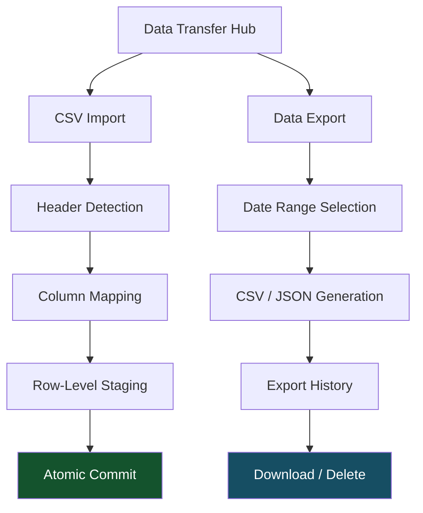
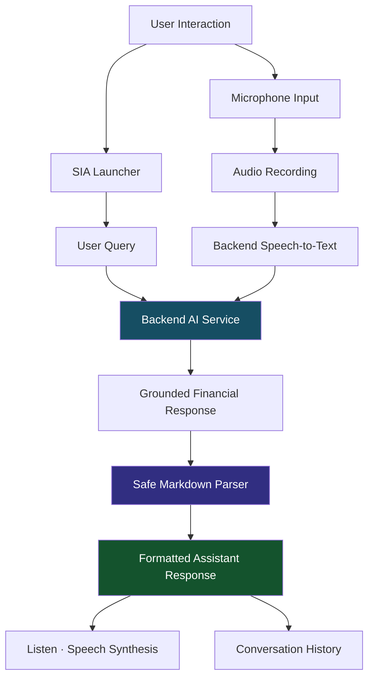
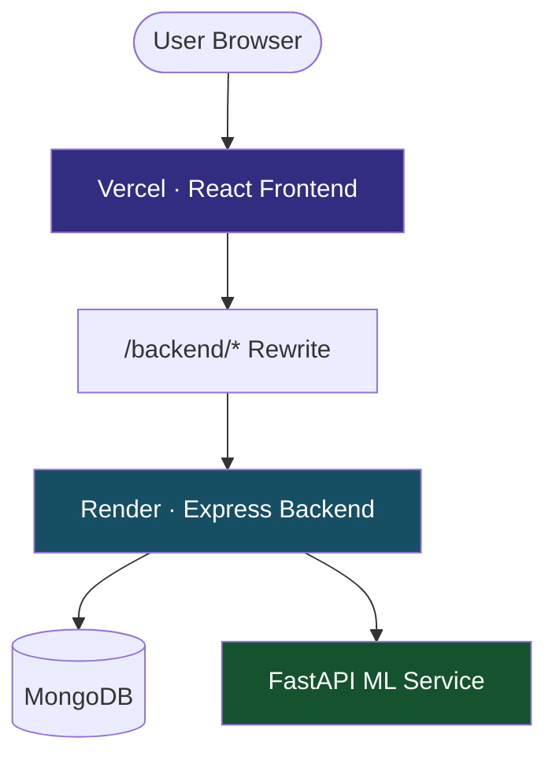

# BALENSIA — Frontend Application

<p align="center">
  
  <br /><br />
  <strong>A Modern Financial Management Experience, Powered by React</strong>
  <br />
  <sub>Smart expense tracking · Financial intelligence · Receipt automation · AI-powered assistance</sub>
  <br /><br />
  <a href="https://github.com/nareshjo001/expense-manager">
    
  </a>
  
  
  
  
  <br />
  
  
</p>

---

## ◈ About BALENSIA

BALENSIA is a modern, responsive financial management application built with **React 19**, designed to make personal finance tracking more intelligent, intuitive, and accessible.

It brings together everyday financial operations, automated receipt processing, interactive analytics, deterministic financial insights, and an AI-powered personal assistant within a unified application experience.

From recording expenses and managing budgets to understanding spending patterns and interacting with SIA, BALENSIA transforms traditional expense tracking into an intelligent financial management ecosystem.

**The application combines seven major experience areas:**

- Smart expense and income management.
- Receipt scanning and intelligent expense linking.
- Unified CSV import and multi-format export.
- Interactive financial visualizations.
- Deterministic insights and monthly AI summaries.
- SIA conversational financial assistant.
- Adaptive design system with dark and light themes.

---

## ◈ Explore the Application

| Section | What You'll Discover |
|:---|:---|
| [01 — Financial Operations](#01--financial-operations--expenses) | Expense entry, filtering, and transaction management |
| [02 — Receipt Intelligence](#02--receipt-inbox--detail-inspection) | OCR review, expense linking, and duplicate detection |
| [03 — Data Transfer](#03--unified-data-transfer) | CSV import and multi-format exports |
| [04 — Charts & Analytics](#04--interactive-visualizations--charts) | Financial trends and category breakdowns |
| [05 — Financial Insights](#05--deterministic-insights--monthly-ai-summary) | Spending analysis and AI summaries |
| [06 — SIA Assistant](#06--sia-smart-intelligent-assistant) | Conversational AI and voice interaction |
| [07 — Design System](#07--design-system--theming) | Responsive layouts and adaptive themes |
| [08 — Route Map](#08--application-route-map) | Application navigation and page components |
| [09 — Architecture](#09--client-architecture--state-flow) | Client state and authentication |
| [10 — Performance](#10--performance-budgets--code-splitting) | Bundle optimization and performance budgets |
| [11 — Setup & Deployment](#11--setup--local-execution) | Development, production, and environment configuration |

---

# 01 — Financial Operations & Expenses

## Smart Expense Management

BALENSIA provides a streamlined expense management experience combining intelligent categorization, advanced filtering, and efficient transaction rendering.

**Smart Expense Entry**

- ML-powered category predictions.
- Calibrated confidence scores.
- Category-aware description generation.
- Intelligent expense categorization.

**Advanced Filtering & Search**

Powered by `ExpenseFilterBar`.

- Dynamic date-range filters.
- Category multi-select.
- Minimum and maximum amount filters.
- Keyword-based transaction search.

**High-Performance Transaction Lists**

- Infinite scrolling.
- Virtualized transaction rendering.
- Efficient handling of extensive financial histories.
- Smooth scrolling with reduced rendering overhead.

**Exact Currency Representation**

Financial amounts are represented using integer paise as the authoritative source and formatted using the Indian Numbering System.

```text
₹1,23,456.50
```

This avoids relying on floating-point values as the authoritative representation of financial amounts.

---

# 02 — Receipt Inbox & Detail Inspection

## Intelligent Receipt Management

The dedicated receipt inbox provides a complete interface for reviewing, correcting, matching, and managing uploaded financial receipts.

### Receipt Lifecycle


### Key Capabilities

**Receipt Inbox**

- Dedicated receipt listing.
- Lifecycle-based filtering.
- Status tracking through:
  - `needs_review`
  - `reviewed`
  - `linked`

**High-Resolution Lightbox**

- Expandable receipt image inspection.
- Built-in zoom/lightbox modal.
- Detailed image viewing without leaving the receipt workflow.

**OCR Confidence & Manual Corrections**

- Per-field OCR confidence badges.
- Editable extracted merchant information.
- Amount correction.
- Date correction.
- Manual review confirmation.

**Smart Expense Linking**

- Automated candidate expense matching.
- Receipt total and date comparison.
- Live search dropdown.
- Linking receipts to existing expense entries.

**Duplicate Detection & Resolution**

- Exact file matching.
- Probable duplicate purchase detection.
- Side-by-side comparison modal.
- User confirmation or dismissal.

---

# 03 — Unified Data Transfer

## CSV Import & Multi-Format Export

The unified `/data-transfer` hub consolidates transaction import and export operations into a single interface.

### Interactive Data Transfer



### CSV Import

- Automatic CSV header detection.
- Interactive column mapping verification.
- Row-level transaction staging.
- Import preview.
- Atomic batch commitment.

### Data Export

- On-demand CSV generation.
- JSON export support.
- Date-range filtering.
- Export history management.
- Past export listing.
- Portal-based action dropdowns.
- Instant download and deletion.

### Unified Navigation

The same component supports dedicated import and export deep links:

- `/data-transfer`
- `/import`
- `/export`

---

# 04 — Interactive Visualizations & Charts

## Financial Data Visualization

BALENSIA transforms financial records into interactive visualizations that make spending patterns easier to understand.

### Multi-Year Trend Analysis

- Multi-series comparative line charts.
- Monthly spending trends.
- Year-over-year comparisons.
- Historical financial analysis.

### Category-Based Analysis

- Bar charts.
- Donut charts.
- Pie charts.
- Expense distribution.
- Budget allocation visualization.

### Chart Architecture

| Visualization | Component | Purpose |
|:---|:---|:---|
| Line Chart | `TrendChartPage` | Multi-year spending trends |
| Bar Chart | `BarChartPage` | Monthly category breakdown |
| Pie Chart | `PieChartPage` | Category-wise distribution |

---

# 05 — Deterministic Insights & Monthly AI Summary

## Financial Intelligence Engine

BALENSIA combines deterministic financial analysis with AI-generated explanations to provide meaningful insights into spending behavior.

### Algorithmic Insights

The insights engine generates structured financial indicators, including:

- Spending habit analysis.
- Financial stability score.
- Week-over-week spending variance.
- Anomaly reports.
- Non-parametric Theil-Sen forecasts.

### Monthly AI Narrative

An AI-powered monthly financial summary that converts verified financial information into structured explanations.

**Key capabilities**

- Fact-grounded monthly summaries.
- Structured financial narratives.
- Expandable source citation pills.
- User-controlled opt-in preferences.
- Evidence-based financial explanations.

### Insights Experience

The `/analysis` page combines deterministic analysis, anomaly detection, forecasting, and monthly AI summaries within a unified interface.

---

# 06 — SIA: Smart Intelligent Assistant

## Your Personal AI Financial Assistant

SIA provides a conversational interface for interacting with financial information through text and voice.

### Assistant Architecture



### Contextual Launcher

- Floating assistant trigger.
- Adaptive desktop presentation.
- Optimized mobile positioning.
- Contextual assistant access.

### Safe Markdown Rendering

- Restricted Abstract Syntax Tree (AST) parser.
- Safe formatting of assistant responses.
- Table rendering.
- HTML injection prevention.

### Audio & Voice Interaction

**Voice Input**

- Browser MIME-type negotiation.
- Audio recording.
- Backend speech-to-text integration.

**Voice Output**

- Web Speech synthesis.
- Read-aloud functionality through the Listen action.

### Conversation Management

- Active conversation switching.
- Historical query sessions.
- Conversation history navigation.
- Session management.

---

# 07 — Design System & Theming

## BALENSIA UI

The application follows a consistent design language focused on visual hierarchy, clarity, responsiveness, and theme adaptability.

### Signature Visual Identity

The BALENSIA interface uses a distinctive vertical accent bar across section and card headings.

```css
width: 4px;
height: 24px;
border-radius: 4px;
background: accent;
gap: 10px;
```

### Responsive Layout Standards

**Desktop**

- Main content bounded to `max-width: 1040px`.
- Structured spacing.
- Consistent card layouts.
- Clear information hierarchy.

**Mobile**

- Optimized padding: `14px 14px 28px`.
- Compact responsive components.
- Touch-friendly controls.
- Adaptive navigation and assistant positioning.

### Dark & Light Themes

- Complete theme-token system.
- Automatic system preference detection.
- Manual theme switching.
- Consistent component styling across both themes.
- Adaptive backgrounds, borders, and text colors.

---

# 08 — Application Route Map

All application routes are rendered within the authenticated application shell in `LandingPage.js`.

## Route Architecture

| Route Path | View Component | Description |
|:---|:---|:---|
| `/` | `ExpensesPage` | Main expenses feed, search filters, infinite scrolling, edit/delete |
| `/budgets` | `BudgetsPage` | Monthly category allocations, budget limits, and spend meters |
| `/add` | `Add` | Unified expense, income, and bill-upload interface |
| `/chart/line` | `TrendChartPage` | Multi-year comparative spending trends |
| `/chart/bar` | `BarChartPage` | Monthly category breakdown |
| `/chart/pie` | `PieChartPage` | Categorical expense distribution |
| `/analysis` | `Insights` | Insights, anomaly reports, forecasts, and AI summary |
| `/rules` | `MerchantRules` | User-defined merchant-to-category rules |
| `/recurring` | `RecurringPage` | Recurring expenses and schedule management |
| `/receipts` | `ReceiptInbox` | Receipt review, smart linking, and duplicate resolution |
| `/data-transfer` | `DataTransfer` | Unified CSV import and export hub |
| `/import` | `DataTransfer` | Direct link to CSV Import tab |
| `/export` | `DataTransfer` | Direct link to Data Export tab |
| `/notification-preferences` | `NotificationPreferences` | Push channels, reminders, and quiet hours |
| `/sia-settings` | `SiaPreferences` | SIA personalization and conversation history management |

---

# 09 — Client Architecture & State Flow

## Frontend State Management

The frontend separates local UI state from server-managed application data using React state primitives and TanStack Query v5.

### Interactive Architecture Specification

Explore the live deployed architecture portal:

<p align="center">
  <a href="https://nareshjo001.github.io/balensia-frontend-architecture/">
    
  </a>
</p>

### Client State Flow

```text
User Action / UI View
│
├── Local State
│   ├── React useState
│   └── React useReducer
│
└── Server State
    └── TanStack Query v5 Hooks
        │
        ├── Query Cache
        │   ├── staleTime
        │   └── Automatic Garbage Collection
        │
        └── Mutations
            ├── Optimistic Updates
            └── Cache Invalidation
                │
                └── Shared API Client
                    └── src/api/axios.js
                        │
                        ├── In-Memory JWT Injection
                        ├── Automatic Session Rotation
                        └── Centralized Error & Conflict Interceptors
```

### Authentication & Session Security

**In-Memory JWT Access Token**

- Access tokens are never stored in `localStorage`.
- Access tokens are never stored in `sessionStorage`.
- Tokens are maintained in memory.

**Rotating Refresh Cookie**

- Refresh tokens are maintained in `HttpOnly` cookies.
- `SameSite` cookie protections.
- Automatic session renewal.

**Double-Submit CSRF Protection**

- State-changing endpoints require CSRF validation.
- Readable CSRF header and cookie values must match.

---

# 10 — Performance Budgets & Code Splitting

## Production Bundle Optimization

BALENSIA enforces gzip-based production bundle performance budgets through:

```text
scripts/checkPerformanceBudgets.js
```

The performance budget system monitors individual chunk categories to prevent unnecessary bundle growth.

### Bundle Performance Targets

| Chunk Category | Baseline Gzip | Target Budget | Monitored Contents |
|:---|---:|---:|:---|
| `main` | ~225 KB | ≤ 247.4 KB | React runtime, router, shared utilities, global layouts |
| `other-chunks` | ~176 KB | ≤ 194.5 KB | Secondary route dependencies and icons |
| `insights` | ~19.9 KB | ≤ 21.9 KB | Financial analysis and AI Monthly Summary |
| `sia` | ~9.4 KB | ≤ 10.3 KB | Assistant, voice recorder, Markdown renderer, session tree |
| `charts` | ~9.5 KB | ≤ 10.5 KB | Recharts and visualization wrappers |
| `bill-upload` | ~1.5 KB | ≤ 1.7 KB | Receipt scanning and image uploads |
| `firebase-push` | ~0.6 KB | ≤ 0.66 KB | Firebase messaging and service worker registration |

### Performance Engineering Principles

- Production bundle monitoring.
- Route and feature-based code splitting.
- Lazy loading of heavier feature modules.
- Gzip performance budgets.
- Bundle composition analysis.
- Dependency growth monitoring.

---

# 11 — Setup & Local Execution

## Getting Started

### Prerequisites

- Node.js and npm.
- Git.
- Access to the BALENSIA backend for full application functionality.

### Installation

Clone the repository and navigate to the frontend directory.

```bash
# Clone the repository
git clone https://github.com/nareshjo001/expense-manager.git

# Navigate to the frontend
cd expense-manager/frontend

# Install dependencies
npm install
```

### Environment Configuration

Create a `.env` file inside the frontend directory.

```env
REACT_APP_BACKEND_URL=http://localhost:8080
REACT_APP_SIA_ENABLED=true
```

### Running Locally

Start the development server:

```bash
npm start
```

The application runs at:

```text
http://localhost:3000
```

### Production Build

Generate an optimized production build:

```bash
npm run build
```

### Performance Budget Validation

Run the gzip performance budget checker:

```bash
npm run perf:budgets
```

---

# 12 — Production Deployment

## Vercel + Render Architecture

The production application uses Vercel for frontend hosting and Render for the Express backend.

### Deployment Architecture



### Vercel Configuration

**Step 01 — Root Directory**

Set the Vercel project root directory to:

```text
frontend
```

**Step 02 — Production Environment Variable**

Configure:

```env
REACT_APP_BACKEND_URL=/backend
```

**Step 03 — Reverse Proxy**

The `vercel.json` configuration automatically proxies:

```text
/backend/*
```

to the Render-hosted Express backend.

### Why This Architecture?

The reverse-proxy approach ensures that authenticated API requests use the frontend's origin.

This allows the `HttpOnly` session cookie to remain first-party to the frontend deployment domain, avoiding third-party cookie restrictions associated with cross-origin authentication.

---

# 13 — NPM Scripts Reference

| Script | Command | Purpose |
|:---|:---|:---|
| `npm start` | `react-scripts start` | Development server with hot reloading |
| `npm test` | `react-scripts test` | Jest and React Testing Library tests |
| `npm run lint` | `eslint src --ext .js` | Frontend ESLint checks |
| `npm run lint:ci` | `eslint ... --max-warnings=0` | CI lint gate with zero warnings |
| `npm run build` | `react-scripts build` | Optimized production build |
| `npm run perf:budgets` | `node scripts/checkPerformanceBudgets.js` | Enforces gzip performance budgets |
| `npm run analyze:bundle-composition` | `node scripts/analyzeBundleComposition.js` | Analyzes module composition and bundle imports |

---

# 14 — Related Documentation

Explore the complete BALENSIA engineering ecosystem.

<p align="center">
  <a href="https://nareshjo001.github.io/balensia-frontend-architecture/">
    
  </a>
  <br /><br />
  <a href="https://github.com/nareshjo001/expense-manager">
    
  </a>
</p>

| Documentation | Location |
|:---|:---|
| Master Project README | [`../README.md`](../README.md) |
| Backend Engine README | [`../backend/README.md`](../backend/README.md) |
| ML Service README | [`../ml-service/README.md`](../ml-service/README.md) |
| API Workflows Index | [`../docs/api-workflows/README.md`](../docs/api-workflows/README.md) |
| Frontend Architecture Portal | [Live Architecture](https://nareshjo001.github.io/balensia-frontend-architecture/) |

---

<p align="center">
  <br />
  <strong>DESIGNED FOR PEOPLE. POWERED BY INTELLIGENCE.</strong>
  <br />
  <sub>Smart finance. Meaningful insights. Seamless experiences.</sub>
  <br /><br />
  <a href="https://github.com/nareshjo001/expense-manager">
    <strong>Explore the BALENSIA Repository →</strong>
  </a>
  <br /><br />
  <sub>© BALENSIA · Frontend Application Documentation</sub>
</p>