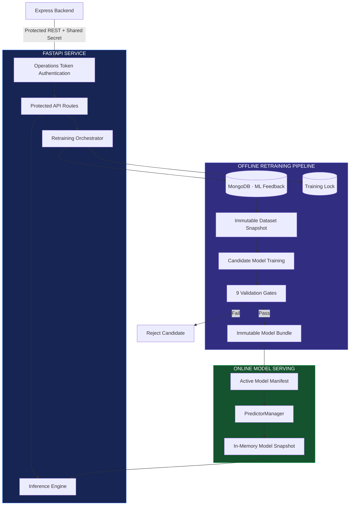
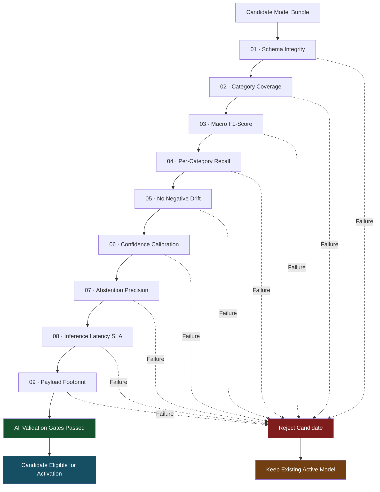
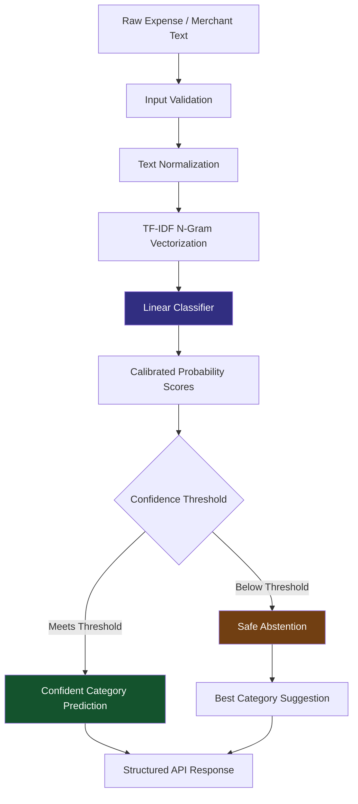
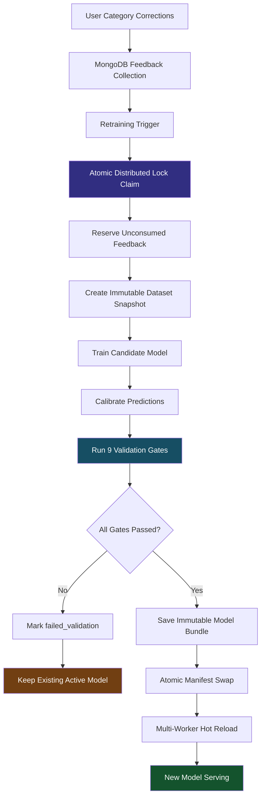

# BALENSIA — Machine Learning Service

<p align="center">
  
  <br /><br />
  <strong>Intelligent Predictions. Guarded Training. Reliable Model Evolution.</strong>
  <br />
  <sub>Real-time expense categorization · Calibrated confidence · Automated retraining · Model lifecycle management</sub>
  <br /><br />
  <a href="https://github.com/nareshjo001/expense-manager">
    
  </a>
  
  
  
  
  <br />
  
  
  
</p>

---

## ◈ About BALENSIA ML Service

The BALENSIA ML Service is a dedicated Python microservice that brings intelligent expense categorization and automated model improvement to the BALENSIA financial ecosystem.

Built with **FastAPI, Scikit-Learn, and MongoDB**, it complements the Express backend by providing low-latency machine learning inference and a controlled background retraining pipeline.

The service goes beyond simply training and serving a classifier. It incorporates calibrated confidence, safe prediction abstention, immutable model artifacts, feedback-driven learning, sequential quality validation, and controlled model activation.

**The ML service brings together five major capabilities:**

- Real-time expense category prediction.
- Calibrated confidence and safe abstention.
- Context-aware transaction description generation.
- Feedback-driven automated model retraining.
- Model validation, activation, monitoring, and rollback.

---

## ◈ Explore the ML Service

| Section | What You'll Discover |
|:---|:---|
| [01 — Core Capabilities](#01--core-capabilities) | Prediction, confidence, descriptions, and observability |
| [02 — System Architecture](#02--system-architecture) | Inference and retraining architecture |
| [03 — Model Validation](#03--the-nine-model-validation-gates) | Nine candidate-model quality checks |
| [04 — Inference Workflow](#04--real-time-expense-category-prediction) | Text processing and classification |
| [05 — Model Lifecycle](#05--guarded-model-retraining-lifecycle) | Feedback, training, and activation |
| [06 — API Reference](#06--api-reference) | Protected and public endpoints |
| [07 — Local Setup](#07--setup--local-execution) | Installation and execution |
| [08 — Configuration](#08--environment-configuration) | Environment variables |
| [09 — Testing](#09--testing--verification) | Automated testing and contracts |
| [10 — Related Documentation](#10--related-documentation) | Architecture and engineering resources |

---

# 01 — Core Capabilities

BALENSIA's ML service combines online prediction with an independently managed offline training lifecycle.

## 1.1 Real-Time Category Prediction

<badge color="success">Online Inference</badge>

Automatically predicts financial categories from raw merchant names and expense descriptions.

**Key characteristics**

- TF-IDF n-gram text vectorization.
- Linear classification models.
- Expense category prediction.
- Low-latency inference.
- Category-aware prediction responses.

Example categories include:

`Food` · `Travel` · `Utilities` · `Essentials` · `Entertainment`

## 1.2 Calibrated Confidence & Safe Abstention

<badge color="info">Prediction Safety</badge>

BALENSIA evaluates prediction confidence before treating a category as reliable.

When confidence falls below the configured category threshold, the service safely abstains rather than presenting an uncertain classification as definitive.

**Abstention response**

```json
{
  "abstained": true,
  "abstentionReason": "low_confidence"
}
```

This allows the application to retain the best category suggestion without incorrectly treating it as a confident prediction.

## 1.3 Context-Aware Description Generation

<badge color="info">Smart Descriptions</badge>

Generates clean, readable transaction descriptions using merchant information and predicted expense categories.

- Merchant-aware suggestions.
- Category-aware description templates.
- Consistent transaction descriptions.
- Automated assistance during expense entry.

## 1.4 Guarded Automated Retraining

<badge color="success">Controlled Model Evolution</badge>

The service incorporates real user feedback into an automated model improvement lifecycle.

**Retraining pipeline**

- Reserve unconsumed feedback.
- Generate immutable dataset snapshots.
- Train isolated candidate model bundles.
- Evaluate candidates against nine validation gates.
- Publish eligible model manifests atomically.
- Reload serving models without downtime.

## 1.5 Comprehensive Observability

Provides operational visibility into service health, model status, and training execution.

| Endpoint | Purpose |
|:---|:---|
| `/health/live` | Process liveness |
| `/health/ready` | Model readiness |
| `/ml-status` | Active model metadata |
| `/training-runs` | Training execution history |

---

# 02 — System Architecture

## Inference & Retraining Architecture

The ML service separates online inference from offline model training, allowing prediction requests to continue while candidate models are developed and evaluated.

### Interactive Architecture Specification

Explore the complete ML service architecture through the live interactive visualizer.

<p align="center">
  <a href="https://nareshjo001.github.io/balensia-ml-service-architecture/">
    
  </a>
</p>

### System Architecture Diagram



### Architectural Responsibilities

| Component | Responsibility |
|:---|:---|
| FastAPI | ML service API and request handling |
| Operations Token | Backend-to-ML service authentication |
| Inference Engine | Category prediction and description generation |
| Retraining Orchestrator | Background training lifecycle |
| MongoDB | Feedback, training runs, and distributed coordination |
| Dataset Builder | Immutable training dataset generation |
| Trainer | Candidate model creation |
| Validation Pipeline | Nine-stage model quality verification |
| Active Manifest | Selects the serving model generation |
| PredictorManager | In-memory model management and reloads |

---

# 03 — The Nine Model Validation Gates

## Candidate Model Quality Assurance

The most important safeguard in BALENSIA's ML lifecycle is its nine-stage candidate validation system.

A newly trained model cannot become eligible for activation until it passes all nine required quality gates.

### Validation Pipeline



## Validation Gate Breakdown

| # | Gate | Validation Objective |
|:---:|:---|:---|
| 01 | Schema Integrity | Verify model artifact structure and required serialized components |
| 02 | Category Coverage | Ensure every active platform category is represented |
| 03 | Macro F1-Score | Ensure overall multi-class F1 meets minimum thresholds |
| 04 | Per-Category Recall | Prevent unacceptable performance drops in individual categories |
| 05 | No Negative Drift | Prevent regression against the active model baseline |
| 06 | Confidence Calibration | Ensure predicted probabilities align with empirical correctness |
| 07 | Abstention Precision | Maintain low error rates for high-confidence predictions |
| 08 | Inference Latency SLA | Keep average batch prediction time within runtime limits |
| 09 | Payload Footprint | Keep serialized model bundle size within allocated disk boundaries |

### Why Nine Gates?

Model accuracy alone is not enough to determine whether a model is production-ready.

A candidate may achieve good overall performance while still:

- Performing poorly on an individual category.
- Producing unreliable confidence scores.
- Failing to abstain on uncertain inputs.
- Increasing inference latency.
- Exceeding storage constraints.

The nine gates evaluate these independent dimensions before a candidate becomes eligible for activation.

---

# 04 — Real-Time Expense Category Prediction

## Online Inference Pipeline

The inference engine converts raw merchant or expense descriptions into structured category predictions.

### Prediction Flow



### Processing Stages

1. Receive the expense description.
2. Validate the incoming request.
3. Normalize merchant and transaction text.
4. Convert text into TF-IDF n-gram features.
5. Run the linear classification model.
6. Calculate calibrated confidence scores.
7. Evaluate the configured confidence threshold.
8. Return a prediction or abstention response.

### Prediction Safety

| Condition | Behavior |
|:---|:---|
| Confidence satisfies threshold | Return confident category |
| Confidence below threshold | Abstain from definitive classification |
| Low-confidence prediction | Preserve best category suggestion |
| Invalid request | Return validation error |

The abstention mechanism ensures that uncertain predictions are distinguishable from reliable classifications.

---

# 05 — Guarded Model Retraining Lifecycle

## Feedback-Driven Model Improvement

BALENSIA uses real user category corrections to improve its expense classification model through an automated retraining process.

The lifecycle is designed to isolate training from production inference and prevent unvalidated candidates from replacing the active model.

### Complete Retraining Workflow



### Retraining Stages

**01 — Feedback Reservation**

- Collect user category corrections.
- Reserve unconsumed feedback.
- Prevent conflicting training claims through distributed coordination.

**02 — Dataset Snapshot**

- Construct an immutable dataset snapshot.
- Combine training data and reserved feedback.
- Maintain an isolated dataset for each training run.

**03 — Candidate Training**

- Train the candidate classifier.
- Perform probability calibration.
- Generate serialized model artifacts.

**04 — Model Validation**

- Execute all nine validation gates.
- Evaluate quality against test splits.
- Compare candidate metrics against baseline metrics.

**05 — Model Publication**

- Store the validated candidate as an immutable model bundle.
- Update the active model manifest atomically.
- Preserve the previous serving model during candidate preparation.

**06 — Multi-Worker Reload**

- Detect active manifest changes.
- Reload the new model in serving workers.
- Continue inference without requiring a service restart.

### Model Lifecycle States

| State | Description |
|:---|:---|
| Created | Training run initialized |
| Running | Dataset preparation or training underway |
| Validation | Candidate undergoing quality evaluation |
| Passed | All validation gates satisfied |
| Failed Validation | Candidate rejected due to validation failure |
| Approved / Rejected | Operator decision through manual deployment hooks |

---

# 06 — API Reference

## ML Service Endpoints

The FastAPI service exposes public health endpoints and protected operational and inference endpoints.

### Authentication

All protected endpoints require the shared operations bearer token:

```http
Authorization: Bearer <ML_OPERATIONS_TOKEN>
```

### Complete Endpoint Catalog

| Method | Endpoint | Access | Description |
|:---:|:---|:---|:---|
| `GET` | `/` | Public | Service name, version, and status metadata |
| `GET` | `/health/live` | Public | Process liveness probe |
| `GET` | `/health/ready` | Public | Confirms active model bundle is loaded |
| `GET` | `/ml-status` | Protected | Active model version, metrics, thresholds, and bundle hash |
| `POST` | `/predict-category` | Protected | Expense category prediction with confidence and abstention |
| `POST` | `/generate-description` | Protected | Category-aware transaction description |
| `POST` | `/retrain-model` | Protected | Starts background model retraining |
| `GET` | `/training-runs` | Protected | Lists previous and active training runs |
| `GET` | `/training-runs/{run_id}` | Protected | Detailed metrics, validation results, and logs |
| `POST` | `/training-runs/{run_id}/approve` | Protected | Operator approval hook |
| `POST` | `/training-runs/{run_id}/reject` | Protected | Operator rejection hook |

### Endpoint Categories

<badge color="success">Public</badge> Health and service availability.

<badge color="info">Protected</badge> Prediction, description generation, model management, and retraining operations.

---

# 07 — Setup & Local Execution

## Getting Started

### Prerequisites

| Requirement | Version |
|:---|:---|
| Python | 3.10–3.14 |
| MongoDB | Accessible database instance |
| pip | Compatible Python package installer |

### Installation

Clone the repository and navigate to the ML service directory.

```bash
# Clone the repository
git clone https://github.com/nareshjo001/expense-manager.git

# Navigate to the ML service
cd expense-manager/ml-service

# Create a virtual environment
python -m venv venv
```

### Activate Virtual Environment

**Windows**

```powershell
venv\Scripts\activate
```

**Linux / macOS**

```bash
source venv/bin/activate
```

### Install Dependencies

Install the exact pinned dependencies:

```bash
pip install -r requirements.txt
```

## Running the Service

### Development Mode

Start FastAPI with automatic reload:

```bash
uvicorn app:app --host 0.0.0.0 --port 8000 --reload
```

### Production Mode

Start with multiple worker processes:

```bash
uvicorn app:app --host 0.0.0.0 --port 8000 --workers 2
```

The service is available at:

```text
http://localhost:8000
```

---

# 08 — Environment Configuration

## ML Service Environment Variables

Create a `.env` file inside the ML service directory.

| Variable | Required | Default | Description |
|:---|:---:|:---|:---|
| `PORT` | No | `8000` | FastAPI server port |
| `MONGO_CONN` | Yes | — | MongoDB connection string |
| `MONGO_DB_NAME` | No | `auth-db` | Database containing ML training and feedback collections |
| `ML_OPERATIONS_TOKEN` | Yes | — | Shared secret for backend-to-ML authentication |
| `ML_MODEL_ROOT` | No | `./training/models` | Root directory for versioned model bundles |
| `LOG_LEVEL` | No | `INFO` | Logging verbosity |

### Example Configuration

```env
# ==========================================
# SERVER
# ==========================================

PORT=8000
LOG_LEVEL=INFO


# ==========================================
# MONGODB
# ==========================================

MONGO_CONN=mongodb://localhost:27017
MONGO_DB_NAME=auth-db


# ==========================================
# SERVICE AUTHENTICATION
# ==========================================

ML_OPERATIONS_TOKEN=your_shared_ml_token_here


# ==========================================
# MODEL STORAGE
# ==========================================

ML_MODEL_ROOT=./training/models
```

<badge color="warning">Security reminder</badge> The operations token must match the corresponding backend configuration. Never commit production credentials or secret values to source control.

---

# 09 — Testing & Verification

## ML Service Quality Assurance

The test suite covers core ML logic, API contracts, failure handling, and retraining workflows.

### Install Test Dependencies

```bash
pip install -r requirements-test.txt
```

### Run Complete Test Suite

```bash
pytest
```

### Run Contract Tests Only

```bash
pytest tests/contracts/
```

### Testing Coverage Areas

| Test Category | Purpose |
|:---|:---|
| Unit Tests | Validate individual ML components |
| Contract Tests | Verify API request and response schemas |
| Failure-Injection Tests | Evaluate error and recovery behavior |
| Training Tests | Verify dataset preparation and candidate training |
| Validation Tests | Test the nine model quality gates |
| Integration Tests | Validate interactions with MongoDB and service components |
| Process Tests | Verify execution across process boundaries |

---

# 10 — Related Documentation

Explore the complete BALENSIA engineering ecosystem.

<p align="center">
  <a href="https://nareshjo001.github.io/balensia-ml-service-architecture/">
    
  </a>
  <br /><br />
  <a href="https://github.com/nareshjo001/expense-manager">
    
  </a>
</p>

| Documentation | Location |
|:---|:---|
| Master Project README | [`../README.md`](../README.md) |
| Express Backend README | [`../backend/README.md`](../backend/README.md) |
| ML Test Architecture Guide | [`tests/README.md`](tests/README.md) |
| Dataset Ambiguity & Audit Guide | [`../docs/ml/ML-001-T02-deduplication-and-label-ambiguity.md`](../docs/ml/ML-001-T02-deduplication-and-label-ambiguity.md) |
| ML Architecture Portal | [Live Architecture](https://nareshjo001.github.io/balensia-ml-service-architecture/) |

---

<p align="center">
  <br />
  <strong>BUILT TO LEARN. ENGINEERED TO EVOLVE.</strong>
  <br />
  <sub>Intelligent predictions. Guarded retraining. Reliable model evolution.</sub>
  <br /><br />
  <a href="https://github.com/nareshjo001/expense-manager">
    <strong>Explore the BALENSIA Repository →</strong>
  </a>
  <br /><br />
  <sub>© BALENSIA · Machine Learning Service Documentation</sub>
</p>